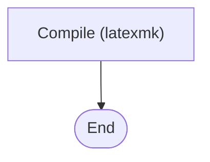

# Fix a Mermaid diagram

The chat shows a `mermaid` block as plain code when the diagram cannot be drawn. You cannot see the rendered result, so work from the source and do not claim that you saw it render.

## Diagnose in this order

1. **Fence**: tagged exactly `mermaid`, closed by a line of three backticks, nothing before the first diagram keyword. An unclosed fence stays code until it closes.
2. **First line**: a valid type (`flowchart TD`, `sequenceDiagram`, `stateDiagram-v2`, `erDiagram`, `gantt`, `timeline`). Not `graph` with a wrong direction, not a stray `%%{init}`.
3. **Quoting**: any label with parentheses, brackets, braces, `#`, `%`, `&`, `;`, a colon, a backslash or a quote inside needs double quotes; a double quote inside a label becomes `#quot;`. CJK text with spaces: quote it.
4. **Reserved ids**: a node or subgraph id named `end`, `graph`, `subgraph`, `style`, `class`, `click`. Rename the id, keep the label.
5. **Balance**: every `subgraph`, `alt`, `opt`, `loop`, `par`, `state X {` has its closing `end` or `}`.
6. **Duplicates**: one id used for two nodes, or the same participant declared with two names.
7. **Disallowed in strict mode**: `click`, `href`, HTML tags other than `<br/>`, `%%{init}`. Remove them.
8. **Type-specific**: in `gantt`, a colon in a task label and non-unique ids; in `erDiagram`, a missing relationship label; in `stateDiagram-v2`, labels containing a colon.

## Simplify when the problem is "too messy"

- More than about 20 nodes: split into an overview and one diagram per group, or collapse a subgraph into one node.
- Crossing edges: reorder declarations so the flow reads in one direction, or flip `TD` and `LR`.
- Long labels: cut to under about 40 characters and move detail into text.

## How to answer

Name the single cause you found in one sentence, then send the corrected block, fence closed. If you found several defects, list them in one line each. Do not switch diagram types to dodge an error, and do not change the diagram's content while fixing syntax. If the source is fine by your reading, say that and ask for the exact text the user sees.

## Example

Broken: the label has parentheses and a node is called `end`.

```
flowchart TD
  A[Compile (latexmk)] --> end
```

Fixed:


