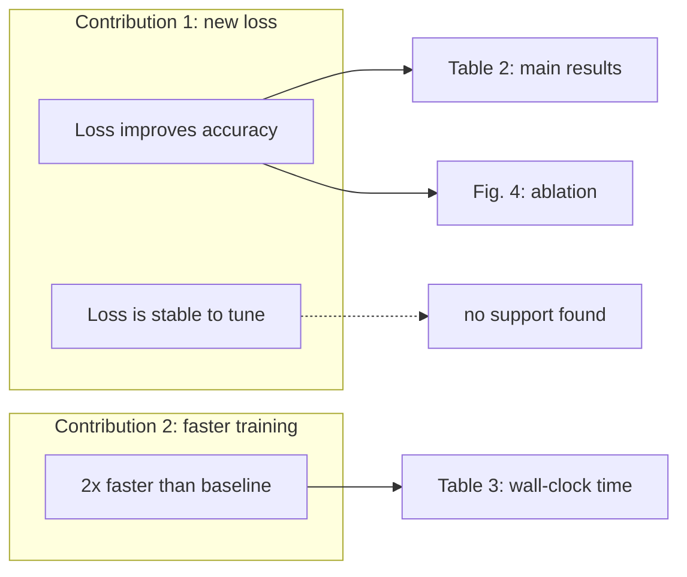

# Paper argument map

A map of what the paper claims and what backs it up. Its value is the gaps it exposes, so the check matters more than the picture.

## Collect first

Read the abstract, introduction (especially the contributions list), method, experiments and conclusion. Extract:

- **Contributions**: what the introduction says is new.
- **Claims**: statements that something is better, faster, necessary, or true.
- **Evidence for each**: a table, figure, theorem, ablation, or citation, by its real label (`Table 2`, `Thm. 1`, `\cref{fig:ablation}`).

Use the author's wording, shortened. Never add a claim the paper does not make.

## Draw

- `flowchart LR`: contributions on the left, claims in the middle, evidence on the right. Group each contribution with `subgraph`.
- Claim -> evidence edges are solid. A claim with no evidence goes to a node `["no support found"]` with a dotted edge `-.->`. Evidence that no claim uses is a node with no incoming edge.
- At most about 20 nodes. If the paper has more claims, map the main ones and say that you did.
- Quote all labels; CJK and math-free text only (no `$...$`, no backslashes). Strict-mode rules as in `flowchart-mermaid`; no colors.

## After the diagram

In text, a short list:
1. Claims with no evidence.
2. Evidence that supports no stated claim.
3. Claims where the evidence is weaker than the wording ("always", "significantly" without a test).

Do not edit the paper. Offer to draft fixes, or to leave comments with `add_comment` on the exact sentences, if the user wants.

## Example

