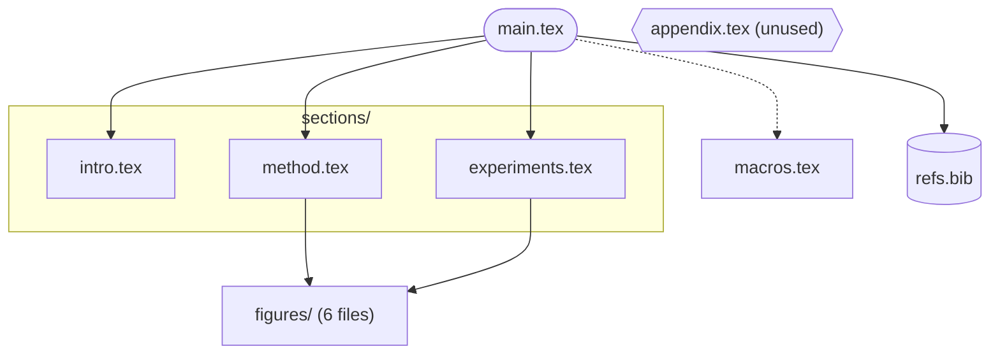

# Project structure map

Show how the project is wired, drawn from what is actually in the files. Never from guesses.

## Collect first

1. `get_project_context` and `list_files` to find the root file and the folder layout.
2. `grep` for the links, in the root file and then in each file it pulls in:
   - includes: `\input{`, `\include{`, `\subfile{`, `\import{`
   - preamble: `\usepackage{`, `\documentclass`, `\newcommand` files such as `macros.tex`
   - assets: `\includegraphics`, `\lstinputlisting`, `\addbibresource`, `\bibliography{`
3. Resolve each name to a real path (extensions are often omitted, and `\graphicspath` may add a prefix). A reference that resolves to no file is **missing**: draw it with a distinct shape and say so.
4. Stop descending once the picture would exceed about 20 nodes. Collapse a folder of figures into one node labeled with a count, for example `figures/ (14 files)`.

## Draw

- `flowchart LR` for a wide project, `flowchart TD` for a deep one.
- Root file is the entry node (`([main.tex])`). Included `.tex` files are rectangles, grouped with `subgraph` by folder. Bibliographies use `[("refs.bib")]`. Figures and tables are a single collapsed node per folder.
- Edges point from the including file to the included one. Use `-.->` for something that is loaded but not part of the text flow (packages, macros).
- Missing or unused files: use `{{ }}` (hexagon) and put `missing` or `unused` in the label. Do not use colors.
- Quote every label (`A["sections/intro.tex"]`). Close every fence. See the `flowchart-mermaid` rules for the rest of the syntax; the fence is rendered in strict mode, so no `click` and no HTML.

## After the diagram

List in text, not in the picture: missing files, files in the project that nothing includes, and files included twice. These are the useful findings. Offer to fix them only if the user asks.

## Example

